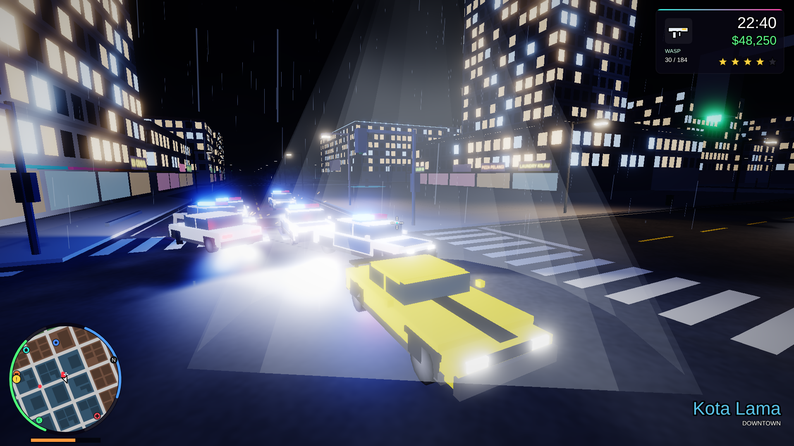

# Selara Bay — Heat on the Coast

<!-- make.fun badges for bounty gta6-01: paste the three live badges from the make.fun kit README template here.
     (The kit was not available when this build was made, so the exact badge markup is left as a placeholder.) -->

**An original 3D open-world crime game that runs in the browser, offline, from static files.** Selara Bay is a tropical coastal city with a third-person camera, cars you can steal, traffic that obeys signals, police that hunt you, and a six-mission story. Everything is generated in code by a **hand-written WebGL2 engine**: the city, every mesh and texture, the lighting, and all sound and music. No libraries, frameworks or asset files, and no build step.



## The story

Kai Santoso comes home to Selara Bay after five years away. Viktor Raza's **Black Orchid** syndicate is squeezing the coast. Kai works with his aunt **Mama Lin**, who runs the garage, and his hacker friend **Dex** to take the city back across six missions: *Homecoming, Yellow Fever, Collections, Wheelman, Low Tide* and *Orchid Falls*. When the credits roll, free roam continues.

## Features

- **City**: a 10×10 grid of ~90 m blocks. Districts: Kota Lama (glass towers, plazas, fountains, neon billboards), Kemuning (terracotta mid-rises with balconies and shop awnings), Bukit Asri (gabled houses, gardens, pools, fences), Pier 9 Docks (warehouses, container stacks, gantry cranes, moored boats), Pantai Selara (beach hotels, umbrellas, palms, a boardwalk and a pier), and parks with ponds. Building footprints vary (box, L-shape, podium + tower, stepped setbacks), with rooftop gardens, pools, solar panels, AC units, tanks, masts and the occasional helipad. There are 11 landmarks, including Orchid Tower with its glowing orchid crown.
- **Streets**: two-lane roads with **left-hand traffic**. Lane markings, zebra crossings, raised curbs, manholes, streetlights, benches, bins and bus stops. Every intersection has **cycling traffic lights**, which traffic AI obeys and pedestrians cross on.
- **Day/night** at one game minute per real second: dawn, noon, golden hour, purple dusk, and dark nights with stars and a moon. Windows light up procedurally, streetlights and neon switch on at dusk, and **rain** brings wet reflective roads, puddles and splashes.
- **Characters** are low-poly humanoids with procedural animation: idle, walk/run cycles, jumping, aiming, a punch combo, hit reactions, falling, phone calls and gesturing.
- **Eight original vehicles**: Kancil, Merpati, Selara Taxi, Vesper GT, Bajak, Bison, Garuda Patrol, and the Rajawali police helicopter. Arcade physics include handbrake drifts, skid marks and tyre smoke, body roll and pitch, lamp posts that break, and damage that goes smoke → fire → explosion with chain reactions.
- **Combat**: Fists, Kobra 9, Wasp and Thunder. Hitscan with tracers, muzzle flashes, sparks, bullet holes, shell casings, recoil, clips and reloading. There are hit markers and damage indicators. Gang AI takes cover behind containers and cars.
- **Wanted level** from 0 to 5 stars, with line-of-sight tracking and a search area. Cop cars chase you along the road graph and ram you, officers deploy on foot, and **roadblocks** appear at 3★. At 3★ the Rajawali joins with a volumetric spotlight cone, and at 4★ it fires bursts. You can shoot it down. Kilat Respray clears your stars.
- **UI**: a rotating circular minimap with a GPS route, a big map with waypoints that also appear as 3D beams, a notification queue whose banners and toasts never overlap, the FLATLINED / CUFFED screens, cutscenes with letterbox bars, portrait cards and subtitles, plus title, pause, settings and stats screens.
- **Audio**: everything is synthesized and positional, using a PannerNode per sound. The engine has RPM and gear shifts, sirens have a doppler-ish two-tone, and the helicopter rotor thumps. Three radio stations run on a step sequencer: *Selara Nights FM* (synthwave), *Ombak Lo-Fi* and *Gamelan Wave*.
- **Side content**: 12 hidden Orchid tags, Bang Bang Arms, Kilat Respray, and a safehouse save point. Autosave runs after every mission.

## Controls

| Action | Key |
| --- | --- |
| Move / drive | W A S D |
| Look / orbit camera | Mouse (pointer lock: click the game) |
| Aim (over the shoulder) | Right mouse |
| Shoot / punch (drive-by in cars) | Left mouse |
| Sprint / jump | Shift / Space |
| Enter, exit, carjack | F |
| Handbrake · horn | Space · H |
| Reload (on foot) · radio (in car) | R |
| Switch weapon | Q / E / mouse wheel |
| City map (click to set a waypoint) | M |
| Cinematic car camera | C |
| Pause | Esc |

Keys can be rebound under **Controls**. **Settings** cover graphics quality (Low/Medium/High), volumes, mouse sensitivity and invert Y.

## How to run

ES modules need HTTP, so serve the `game/` folder with any static server:

```bash
npx serve game
```

Then open the printed URL in desktop Chrome. `python3 -m http.server -d game` works too. On Vercel, `vercel.json` serves `game/` directly with no build step.

Debug scene hook (used for the screenshots): `index.html?shot=1..4`.

## Engine

The renderer in `game/js/engine/` is written from scratch on raw **WebGL2**:

- **Frame graph** (`renderer.js`): a directional **shadow pass** (2048² on High, fitted to the camera focus, texel-snapped, 3×3 PCF), then an **HDR scene pass** into an RGBA16F target with the sky dome, culled static chunks, instanced batches, per-draw vehicles, water, billboard particles and additive light volumes. Last comes **post-processing** (`post.js`): a bright pass, a 5-level **bloom** down/up chain, **ACES tone mapping**, a per-time-of-day colour grade, a vignette, and pause blur.
- **Lit shader** (`shaders/lit.js`): sun/moon plus hemisphere ambient, and up to 32 forward **point and spot lights** (headlights, streetlights, sirens, neon, the helicopter spotlight). **Procedural windows** use world-space UVs and per-window hashes, so they glow warm or cool at night and read as reflective glass by day. Wet asphalt gets puddle masks and specular, cars get glass fresnel, and emissive signs come from a text atlas.
- **Geometry**: `mesh-builder.js` generates boxes, beveled boxes, cylinders, spheres, gables and wheels. The city is merged into **chunk meshes per 2×2 blocks** with **frustum culling** (`frustum.js`). Trees, lamps, props, wheels, pickups and every character limb are drawn **instanced** (`instancing.js`).
- **Sky and water** (`sky.js`, `shaders/sky.js`, `shaders/water.js`): a time-of-day gradient with sun, moon, stars and clouds, exponential height fog, and a vertex-wave sea with fresnel, sun glints and shoreline foam.
- **Performance**: Low/Medium/High presets set shadow size, bloom, draw distance and light count. Render resolution adapts to the frame rate, and crowd density follows a frame budget.

Gameplay is **simulated in 2D and rendered in 3D**: movement, collision (a spatial hash of AABBs and posts), AI, traffic, police and missions all run on the ground plane at a fixed 60 Hz.

## Screenshots

| | |
| --- | --- |
|  |  |
|  |  |

## Source layout

```
game/index.html, style.css
game/js/main.js                 boot, fixed-step loop, state machine
game/js/scene.js                per-frame scene assembly for the renderer
game/js/camera-rig.js           third-person, chase, cinematic and cutscene cameras
game/js/core/                   state.js, input.js (pointer lock, bindings), math.js (vec3/mat4/RNG)
game/js/engine/                 gl.js, renderer.js, mesh-builder.js, instancing.js, shadows.js,
                                sky.js, post.js, frustum.js, shaders/{lit,shadow,sky,water,particles,post,beam,common}.js
game/js/world/                  city.js, city-meshes.js, props.js, signs.js, roads.js, collision.js
game/js/entities/               player.js, character-model.js, vehicle.js, vehicle-model.js, pedestrian.js, pickups.js
game/js/ai/                     traffic.js, police.js (wanted, roadblocks, helicopter), combat-ai.js
game/js/combat/weapons.js       hitscan, melee, explosions
game/js/fx/                     particles.js, lights.js, weather.js
game/js/story/                  missions.js, dialogue.js, side-content.js
game/js/ui/                     hud.js, minimap.js, bigmap.js, menus.js, theme.js
game/js/audio/                  audio.js (positional SFX), radio.js (three stations)
game/js/save.js                 versioned localStorage save
tools/playtest.mjs              automated Playwright play-through (all 6 missions)
tools/screenshots.mjs           captures the README screenshots
```

## License

MIT © I Wayan Bagus Somabawa
