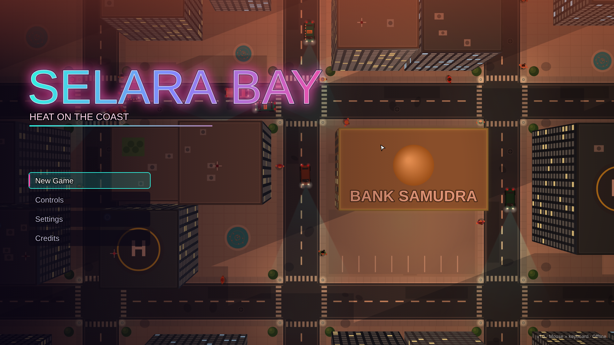
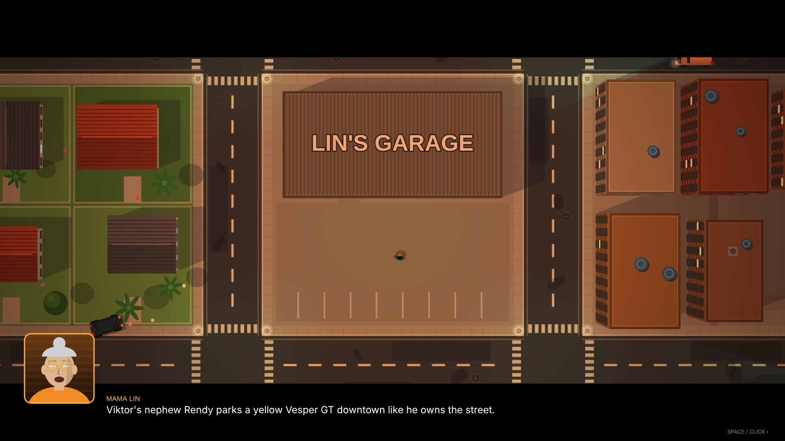
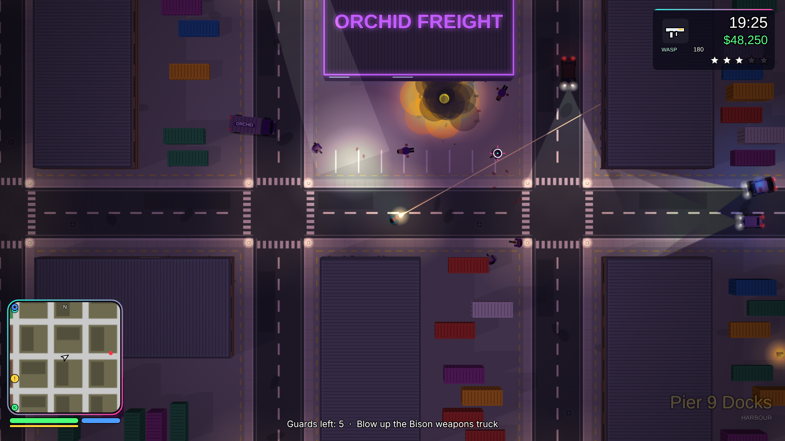

# Selara Bay — Heat on the Coast

<!-- make.fun badges for bounty gta6-01: paste the three live badges from the make.fun kit README template here.
     (The kit was not available when this build was made, so the exact badge markup is left as a placeholder.) -->

An original top-down open-world crime game that runs offline in desktop Chrome from static files. Everything is generated in code: the city, all art (Canvas 2D), all sound and music (Web Audio). No images, fonts or audio files, and no build step.

Kai Santoso comes home to the tropical coastal city of **Selara Bay** after five years away. Viktor Raza's **Black Orchid** syndicate is squeezing the coast. With his aunt **Mama Lin** at the garage and his hacker friend **Dex**, Kai takes the city back across six story missions.



## Features

- **A 12×12-block procedural city** in 2.5D: extruded buildings with floor bands and window grids, roofs that lean away from the camera, sun shadows that follow the time of day, and lit windows at night. Six districts each have their own building style: Kota Lama downtown towers, Kemuning midtown, Bukit Asri houses with pools, Pier 9 Docks with containers and cranes, the Pantai Selara beach row, and parks. Eleven landmarks, an animated sea, a beach, piers and fountains.
- **Day/night cycle** (1 real second = 1 game minute) with a golden sunset and a light map at night (headlight cones, streetlights, neon, police lightbars, helicopter spotlight). Rain showers bring puddle sheen and less tyre grip.
- **Seven original vehicles**: Kancil, Merpati, Selara Taxi, Vesper GT, Bajak, Bison and Garuda Patrol. Arcade physics with drifting, handbrake, skid marks, tyre smoke, collisions, and damage that goes smoke → fire → explosion, with chain reactions.
- **Left-hand traffic** that follows lanes on the road graph, takes bezier turns, brakes for obstacles, honks and backs out when stuck. Pedestrians walk around the blocks, cross at the zebras, and flee danger.
- **Combat**: fists, Kobra 9, Wasp SMG and Thunder shotgun. Hitscan with spread, tracers, muzzle flashes, drive-by shooting, and Black Orchid gang AI that keeps its distance and strafes.
- **Wanted system** from 0 to 5 stars. Police need line of sight to track you, and a search area appears when you're out of sight. Cop cars chase and ram you and drop officers on foot; a helicopter with a spotlight joins at 3★ and opens fire at 4★.
- **Six story missions** with cutscenes (letterbox bars, drawn portraits, subtitles), failure and retry, and an ending with a credits roll. Side content: 12 hidden Orchid tags, Bang Bang Arms (gun shop) and Kilat Respray (clears your wanted level for $100).
- **HUD**: clock, money, weapon, stars, a rounded minimap with GPS, a full city map with clickable waypoints, and health/armor/stamina bars.
- **Radio**: *Selara Nights FM* (synthwave) and *Ombak Lo-Fi*, both generated by a step sequencer.
- **Saving** at the safehouse marker, plus an autosave after every mission. Settings for volume and mute, and remappable keys.

## Controls

| Action | Key |
| --- | --- |
| Move / drive | W A S D (or arrow keys) |
| Aim / shoot (also drive-by) | Mouse / left click |
| Sprint | Shift |
| Enter / exit / carjack | F |
| Handbrake | Space |
| Horn | H |
| Switch weapon | Q / E / mouse wheel |
| Radio station | R |
| City map (click to set a waypoint) | M |
| Pause | Esc |
| Skip dialogue | Space / Enter / click |

Keys can be remapped under **Controls**.

## How to run

The game must be served over HTTP, because ES modules don't load from `file://`:

```bash
npx serve game
```

Then open the printed URL in desktop Chrome. Any static server works, for example `python3 -m http.server -d game`. On Vercel, `vercel.json` serves `game/` directly.

Debug scene hook used for the screenshots: `index.html?shot=1..4`.

## Screenshots

| | |
| --- | --- |
|  |  |
|  |  |

## Source layout

```
game/index.html, style.css
game/js/main.js              boot, game loop, state machine
game/js/state.js             shared game state
game/js/input.js             keyboard + mouse, rebinding table
game/js/util.js              math, seeded RNG, colours
game/js/camera.js            follow camera, look-ahead, zoom, shake
game/js/world/               city.js (generation), render-city.js (2.5D), collision.js, roads.js (graph)
game/js/entities/            player.js, vehicle.js, pedestrian.js, pickups.js
game/js/ai/                  traffic.js, police.js (wanted + helicopter), combat-ai.js
game/js/combat/weapons.js    hitscan, melee, explosions
game/js/fx/                  particles.js, lighting.js (day/night, light map, rain)
game/js/story/               missions.js, dialogue.js, side-content.js
game/js/ui/                  hud.js, menus.js, theme.js
game/js/audio/audio.js       SFX, loops, radio sequencer
game/js/save.js              localStorage save/load
game/js/debug/screenshots.js ?shot=N scene setup
tools/                       Playwright screenshot + automated play-through scripts
```

## License

MIT © I Wayan Bagus Somabawa
